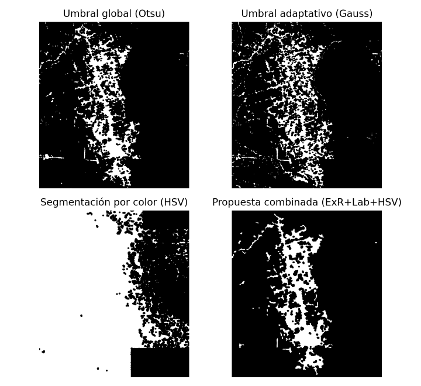
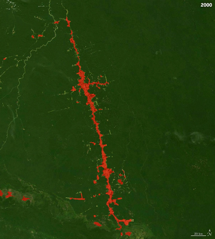
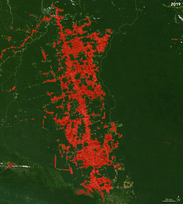
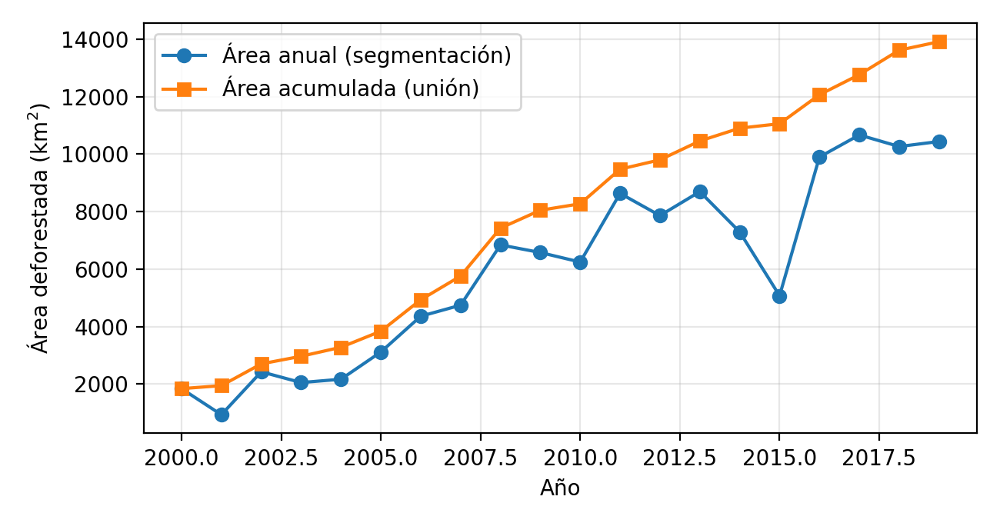

# Deforestación en la Amazonia mediante segmentación de imágenes satelitales

Cuantificación de la superficie deforestada en el **Bosque Nacional Jamanxim (Brasil)** a
partir de 20 imágenes Landsat anuales (2000–2019) en color natural, mediante segmentación
automática por índices de color y morfología matemática.

**Stack:** Python · OpenCV · NumPy · matplotlib

## Pipeline anual

1. Lectura RGB y normalización a [0, 1]; suavizado Gaussiano (σ ≈ 1–2 px).
2. Conversión a **HSV** y **Lab**; CLAHE sobre la luminancia L.
3. Índices de color: **ExR = 2R − G − B** y **ExG = 2G − R − B**.
4. Umbrales automáticos con **Otsu**.
5. **Máscara combinada:** intersección de condiciones sobre ExR (Otsu), los canales a/b/L de
   Lab y un rango HSV compatible con suelo expuesto.
6. Postprocesado morfológico: apertura, cierre y eliminación de componentes conexas pequeñas.
7. Conversión de píxeles a km² con la escala de la imagen (20 km ≙ 51 px):
   `A = N · (20/51)²` km². El área acumulada se obtiene como la unión temporal de las máscaras.

Se compararon cuatro enfoques: umbral global (Otsu), umbral adaptativo, segmentación por
color en HSV y el método combinado. El combinado es el más estable entre años, porque los
enfoques basados solo en intensidad son sensibles a la iluminación de cada escena.

## Resultados

| 2000 | 2019 |
|---|---|
|  |  |

| Año | Área anual (km²) | Área acumulada (km²) |
|---|---:|---:|
| 2000 | 1.839 | 1.839 |
| 2005 | 3.115 | 3.994 |
| 2010 | 6.246 | 8.567 |
| 2015 | 5.073 | 11.061 |
| 2019 | 10.442 | 13.915 |

La superficie segmentada se multiplica por más de 5 entre 2000 y 2019. Como limitación, el
error en la medida de la escala (píxeles por km) se propaga cuadráticamente al área estimada.
