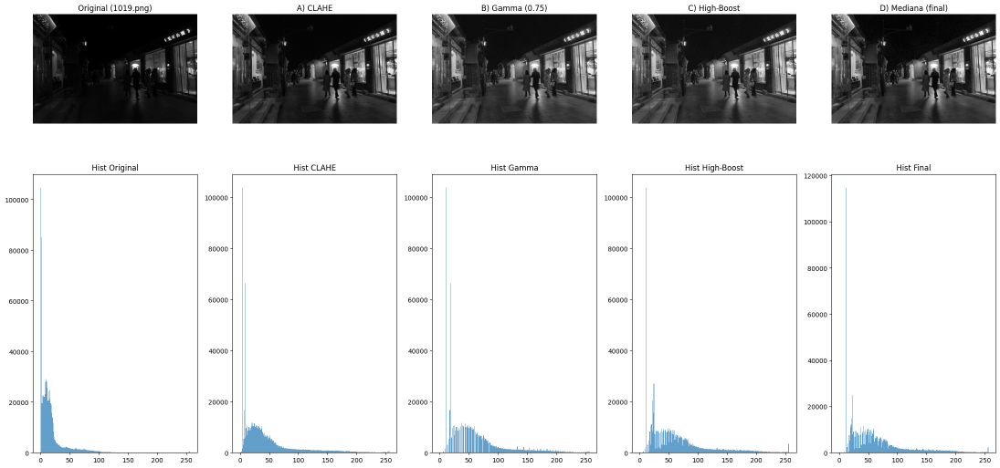
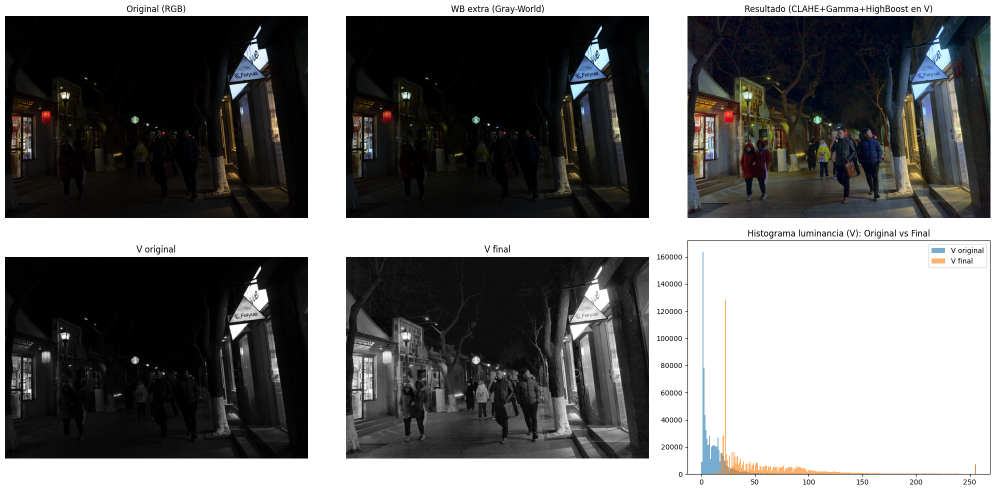

# Realce de imágenes con baja iluminación

Mejora de la visibilidad en imágenes nocturnas reales del dataset **DARK FACE** mediante
técnicas clásicas de procesado del histograma, transformaciones puntuales y operadores
aritméticos. El efecto se evalúa visualmente y con estadísticos de intensidad (media,
desviación, coeficiente de variación, asimetría, curtosis y entropía).

**Stack:** Python · OpenCV · NumPy · matplotlib

## Implementación

Para cada imagen se diseñó un pipeline de 3 a 5 etapas, implementado en Python con OpenCV y NumPy. La tabla resume cada técnica y las funciones de referencia:

| Etapa | Técnicas | Funciones de referencia |
|---|---|---|
| Histograma | CLAHE (igualación local con límite de contraste); ecualización global con *clipping* de bins | `cv2.createCLAHE`; LUT a partir de la CDF recortada |
| Transformación puntual | Corrección gamma (γ < 1); transformación a trozos por percentiles (p95, p99) | LUT `255·(I/255)^γ`; remapeo por tramos |
| Operador aritmético | Suma de constante; realce **high-boost** `I + k·(I − G(I))`; *blend* con la original | `cv2.GaussianBlur`, `cv2.addWeighted` |
| Reducción de ruido | Mediana; **Non-Local Means** | `cv2.medianBlur`, `cv2.fastNlMeansDenoising` |
| Color | Balance de blancos **Gray-World** y realce solo sobre el canal V (HSV) para preservar tono y saturación | `cv2.cvtColor` RGB↔HSV |

## Resultados

| Imagen | Pipeline | Media | Entropía | CV |
|---|---|---|---|---|
| 1 (gris) | CLAHE + gamma + suma + mediana | 8,1 → **85,5** | 3,92 → **5,22** | — |
| 2 (gris) | CLAHE + gamma + high-boost + mediana | 17,6 → **61,8** | 5,36 → **6,65** | 1,57 → 0,81 |
| 3 (gris, extrema) | A trozos + HistEq con *clipping* + blend + NLM + mediana | 11,1 → **27,2** | 4,23 → **5,71** | 2,86 → 1,72 |
| 4 (color, canal V) | Gray-World + CLAHE + gamma + high-boost sobre V | 17,4 → **63,3** | 5,00 → **6,48** | 2,05 → 0,79 |

En todos los casos baja la asimetría y la curtosis (el histograma deja de concentrarse en
negros) y sube la entropía (más niveles de intensidad ocupados).

## Conclusiones

- La combinación **histograma + ajuste puntual + operador aritmético** es robusta para
  escenas nocturnas.
- El *high-boost* recupera contornos mejor que una simple suma de brillo.
- Realzar solo la luminancia (canal V) evita artefactos cromáticos en imágenes en color.
- Los filtros de ruido (mediana, NLM) son necesarios: al expandir las sombras se amplifica
  el grano, y sin ellos parte del aumento de entropía sería ruido y no detalle.
