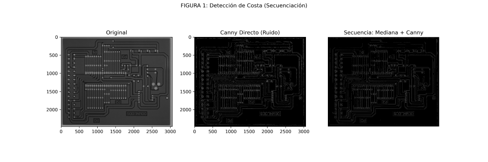
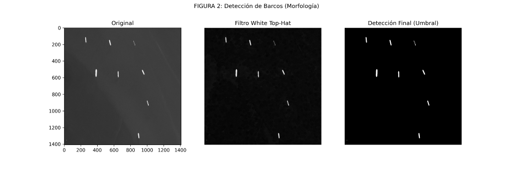
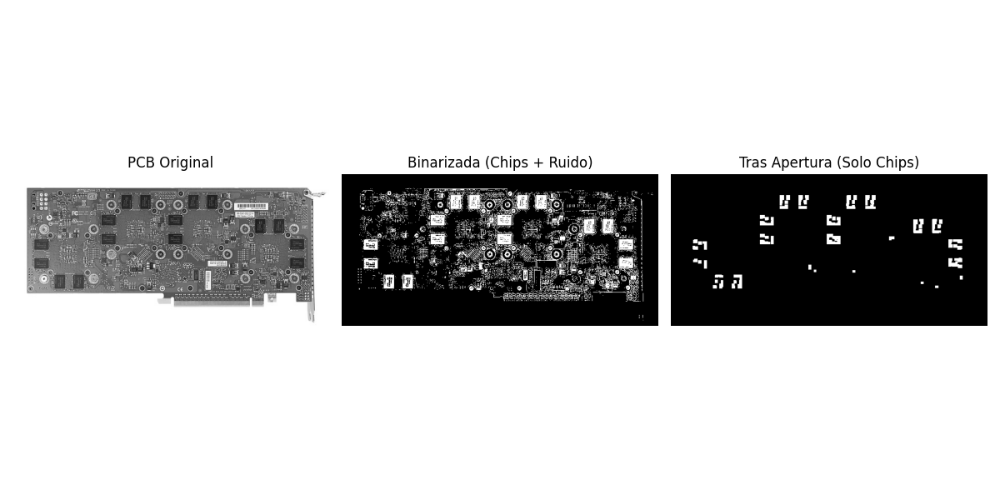
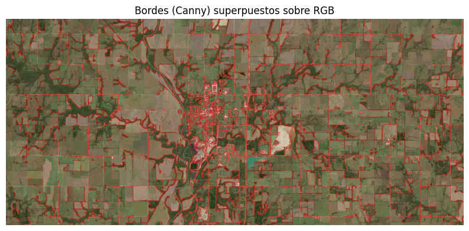
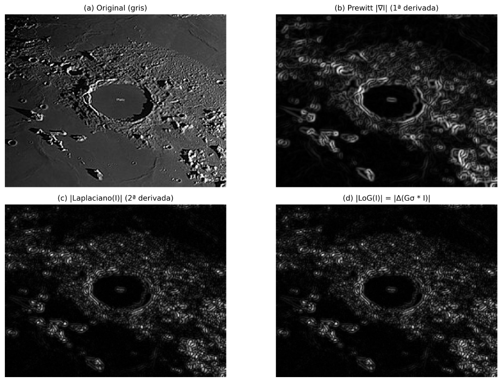

# Filtros espaciales y morfología matemática en escenarios reales

Comparativa de **filtros espaciales** (suavizado, derivadas, detección de bordes) y
**operaciones morfológicas** (erosión/dilatación, apertura/cierre, gradiente, *top-hat*)
en 10 escenarios reales de distinta naturaleza: inspección industrial, teledetección,
imagen biomédica y planetología. Las imágenes proceden de repositorios abiertos.

**Stack:** Python · OpenCV · NumPy · matplotlib

## Flujo común

1. **Normalización del dominio:** escala de grises, o HSV cuando el color aporta
   separabilidad.
2. **Preprocesado:** filtrado paso bajo (media, mediana o Gaussiano) antes de derivar o
   umbralizar.
3. **Operadores principales:**
   - Espaciales: Sobel/Prewitt (1.ª derivada), Laplaciano (2.ª), LoG y Canny
     (`cv2.Sobel`, `cv2.Laplacian`, `cv2.Canny`).
   - Morfológicos: `cv2.morphologyEx` con `MORPH_OPEN`, `MORPH_CLOSE`, `MORPH_GRADIENT`,
     `MORPH_TOPHAT` y `MORPH_BLACKHAT`, con elementos estructurantes ajustados a cada caso.
4. **Postprocesado:** umbralización y superposición de contornos sobre la imagen original.

## Casos seleccionados

**Inspección de PCB: Canny directo frente a mediana + Canny.** Suavizar antes de derivar
elimina bordes espurios de la textura y mejora la continuidad de las pistas.

**Vigilancia marítima (satélite): white top-hat.** Resalta objetos pequeños y brillantes
(barcos) sobre un fondo de oleaje no homogéneo.

**Filtrado por tamaño en PCB: apertura morfológica.** Conserva solo los componentes
mayores que el elemento estructurante (los *chips*) y elimina el ruido.

**Teledetección agrícola (Sentinel-2): cadena espacial y superposición de bordes.**

**Planetología: 1.ª frente a 2.ª derivada y LoG.**

El estudio completo incluye además radiografía (*black top-hat*), micrografía de acero,
ecografía, dermatología y microscopía biomédica (segmentación por color + limpieza
morfológica).

## Conclusiones

- **La secuencia de operadores es determinante:** suavizar antes de derivar reduce respuestas
  espurias en imágenes con textura o ruido.
- **La morfología destaca cuando importa la geometría:** filtrado por tamaño, consolidación
  de regiones y estimación del fondo (*top-hat*).
- **No existe un filtro universal:** la elección depende de la modalidad de imagen y del
  objetivo (reducir ruido, detectar bordes, segmentar).
