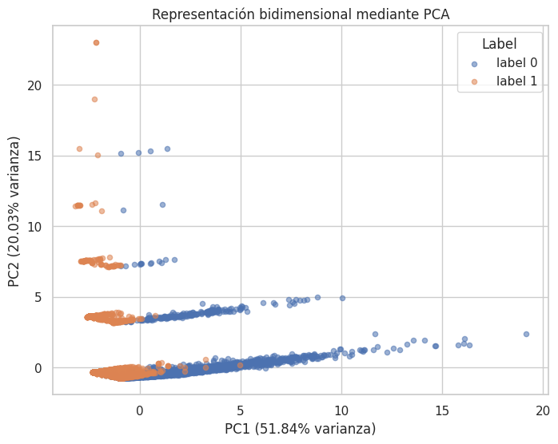
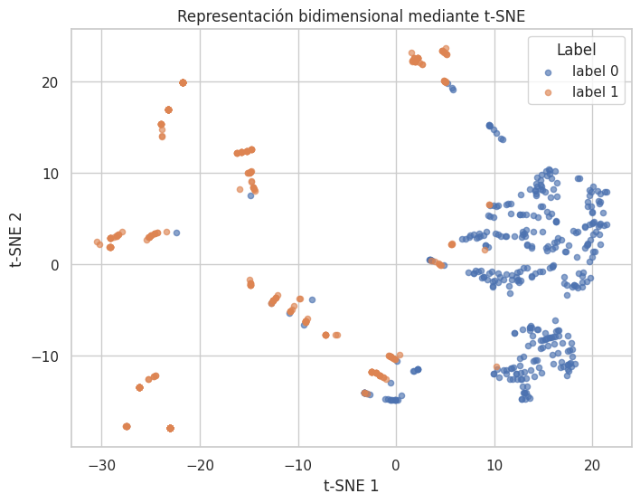

# Reducción de dimensionalidad (PCA, t-SNE) y modelado de temas (LDA)

Proyección a 2D de 10.000 comentarios etiquetados (odio / no odio) a partir de 10 rasgos
numéricos estandarizados, comparando una técnica lineal (**PCA**) con una no lineal
(**t-SNE**). Como complemento, se extraen temas latentes del texto con **LDA**.

**Stack:** pandas · scikit-learn (PCA, TSNE, LatentDirichletAllocation, CountVectorizer) · matplotlib · seaborn

| PCA | t-SNE |
|---|---|
|  |  |

## Resultados

| Técnica | Resultado |
|---|---|
| **PCA** | PC1 + PC2 explican el **71,9 %** de la varianza; un clasificador entrenado solo con esas 2 componentes alcanza un **97,3 %** de accuracy |
| **t-SNE** | Agrupamientos locales claros; un clasificador sobre la proyección alcanza un **94,3 %** (muestra estratificada de 700 observaciones) |
| **LDA** | 5 temas globales y temas por etiqueta, con diferencias de vocabulario entre ambas clases |

**Conclusión:** PCA es la técnica más adecuada para una reducción **interpretable y
estable**, porque sus ejes se relacionan con las variables originales mediante las cargas.
t-SNE es más útil como herramienta de **visualización**: sus coordenadas dependen de la
muestra y de los hiperparámetros, por lo que no conviene usarlas como variables de un modelo.

## Datos

El notebook espera `data/out.csv` (no incluido en el repositorio); se publica con todas las
salidas.
